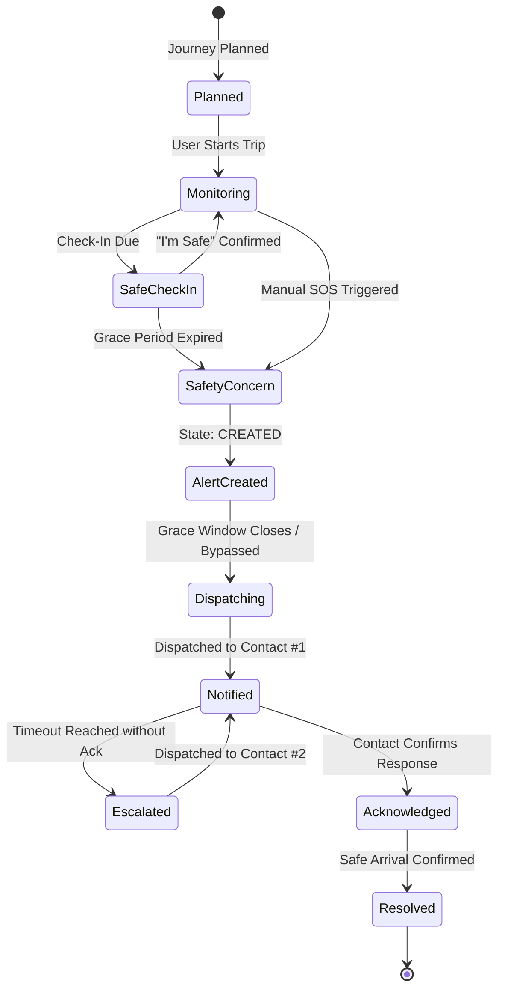

# SafePath — Resilient Personal Safety & Journey Monitoring Platform

> **SafePath** is a full-stack MERN progressive web application (PWA) designed to empower women and vulnerable commuters through active journey monitoring, scheduled safety check-ins, multi-channel alert delivery, and a persistent server-side **Safety Relay** state machine that escalates alerts until a trusted contact confirms they are responding.

---

## 1. Product Objective & The Safety Relay Differentiator

Traditional emergency apps merely send a static SMS panic message and stop. SafePath introduces the **Safety Relay**:



### Core Relay Cycle:
1. **Journey Monitoring**: Real-time GPS coordinates and check-in countdown timer (every 10–45 mins).
2. **Safety Concern**: Triggered when a scheduled check-in window and grace period expire without confirmation, or when the user triggers the manual Emergency SOS action.
3. **Alert Delivery**: Dispatches alerts with live GPS coordinates, accuracy, and trip destination via Resend Email, Web Push, and Twilio SMS to Priority #1 contact.
4. **Contact Acknowledgment**: Contact taps a secure, tokenized link to view live incident details and confirms: *"I acknowledge & am responding."*
5. **Escalation**: If Priority #1 does not acknowledge within the configured timeout window, SafePath automatically notifies the next verified contact in the safety circle.
6. **Safe Resolution**: Incident is marked safely resolved with audit notes once safe arrival is confirmed.

---

## 2. Technical Stack

| Layer | Technologies |
| :--- | :--- |
| **Frontend** | React 18, Vite, JavaScript, Tailwind CSS, React Router v6, Lucide Icons, Framer Motion, Leaflet with OpenStreetMap, Socket.IO Client, `idb` (IndexedDB) |
| **PWA & Offline** | Web App Manifest, Service Worker (`vite-plugin-pwa`), IndexedDB Offline Queue with auto-synchronization upon network recovery |
| **Backend** | Node.js (v24), Express.js (ESM), Socket.IO, Helmet, CORS, Morgan, Cookie-Parser, Bcrypt.js, JSON Web Tokens (JWT) |
| **Database** | MongoDB Atlas with Mongoose (with zero-config embedded `mongodb-memory-server` for local development/testing) |
| **Validation & Security** | Zod input validation, express-rate-limit, HTTP-only SameSite cookies, CSRF protection, sanitized audit logging |
| **Provider Adapters** | Resend (Transactional Email), Twilio (SMS), Web Push API (VAPID Browser Push), OpenRouteService (Turn-by-turn routing), OpenAI (Objective incident summaries) |

---

## 3. Product Limitations & Legal Honesty Notice

SafePath adheres to strict honesty regarding hardware and software limits:
- **No Guarantee of Physical Rescue**: SafePath is an alerting and coordination tool. SafePath never claims that an alert guarantees physical rescue or that an unacknowledged check-in proves physical danger.
- **Does Not Replace 911 / 112**: In immediate life-threatening situations, municipal emergency dispatch services should always be contacted directly.
- **Network Dependency**: Real-time alerts require an active internet connection. Offline queuing stores events in browser IndexedDB but cannot transmit over the air until connectivity returns.
- **Browser Background Limits**: Standard mobile browsers restrict continuous GPS tracking when the screen is locked or browser is closed. Users are instructed to keep SafePath open during critical travel segments.
- **No Artificial Danger Scores**: SafePath does not manufacture speculative "AI danger scores" or accuse persons nearby. All triggers are deterministic, rule-based, and user-configured.

---

## 4. Getting Started (Windows PowerShell)

### Prerequisites:
- **Node.js** v18+ (tested on Node v24.19.0)
- **npm** v10+

### Step 1: Clone & Install Dependencies
```powershell
# From project root
npm.cmd run install:all
```

### Step 2: Configure Environment Variables
Copy `.env.example` in `backend` to `.env`:
```powershell
Copy-Item backend\.env.example backend\.env
```
> *Note: SafePath is pre-configured with `USE_MEMORY_DB=true` so you can test immediately without needing an external MongoDB Atlas cluster.*

### Step 3: Seed Safe Demo Data
```powershell
npm.cmd --prefix backend run seed
```
Demo account:
- **Email**: `maya@safepath.app`
- **Password**: `SafePath123!`
- Pre-configured with 3 verified contacts (Elena, Marcus, Sarah) and an active monitored journey!

### Step 4: Run Tests
```powershell
npm.cmd --prefix backend test
```
Runs 17 automated tests covering authentication, trusted contacts, journey monitoring, check-ins, manual SOS idempotency, and Safety Relay escalation.

### Step 5: Start Development Servers
```powershell
# Starts backend (port 5000) and frontend (port 5173) concurrently
node scripts/dev.js
```
Open **[http://localhost:5173](http://localhost:5173)** in your browser.

---

## 5. API Reference (`/api/v1`)

| Endpoint | Method | Auth | Description |
| :--- | :---: | :---: | :--- |
| `/auth/register` | `POST` | Public | Register new user account |
| `/auth/login` | `POST` | Public | Sign in and receive HTTP-only cookie + JWT |
| `/auth/logout` | `POST` | Public | Clear auth cookie |
| `/auth/me` | `GET` | User | Retrieve current user profile |
| `/contacts` | `GET` | User | List user's trusted contacts sorted by priority |
| `/contacts` | `POST` | User | Invite a new contact (sends verification email) |
| `/contacts/reorder` | `PUT` | User | Reorder priority ranks |
| `/contacts/verify/:token` | `POST` | Public | Contact confirms or declines invitation |
| `/trips` | `POST` | User | Plan a new journey with route coordinates & ETA |
| `/trips/:id/start` | `POST` | User | Start journey & schedule first check-in |
| `/trips/:id/location` | `POST` | User | Stream live GPS location ping |
| `/trips/:id/complete` | `POST` | User | Mark arrived safely and complete monitoring |
| `/check-ins/:id/acknowledge`| `POST` | User | Confirm "I'm Safe" and schedule next check-in |
| `/alerts/manual` | `POST` | User | Trigger manual SOS with idempotency key |
| `/alerts/token/:token` | `GET` | Public | Contact portal to view incident details & map |
| `/alerts/token/:token/acknowledge` | `POST` | Public | Contact confirms: "I am responding" |
| `/alerts/:id/resolve` | `POST` | User | Safely resolve emergency with audit notes |
| `/push/subscribe` | `POST` | User | Register browser Web Push subscription |
| `/users/export` | `GET` | User | Download complete GDPR JSON personal archive |
| `/users/account` | `DELETE` | User | Permanently purge account & all associated data |

---

## 6. Production HTTPS Deployment

### Backend Deployment (e.g. Render / Railway / Fly.io):
1. Set Environment Variables:
   - `NODE_ENV=production`
   - `MONGODB_URI=mongodb+srv://<user>:<password>@cluster.mongodb.net/safepath`
   - `CLIENT_URL=https://your-safepath-frontend.vercel.app`
   - `JWT_SECRET=<32+ char secret>`
   - `COOKIE_SECRET=<32+ char secret>`
   - `VAPID_PUBLIC_KEY` & `VAPID_PRIVATE_KEY` (generate via `npx web-push generate-vapid-keys`)
   - `RESEND_API_KEY` (from [resend.com](https://resend.com))
2. Start Command: `node src/server.js`

### Frontend Deployment (e.g. Vercel / Netlify / Cloudflare Pages):
1. Build Command: `npm run build`
2. Output Directory: `dist`
3. Environment Variables:
   - `VITE_API_URL=https://your-backend-api.onrender.com`

---

## 7. License

SafePath is distributed under the MIT License. Built with care for women's safety and resilient journey monitoring.
